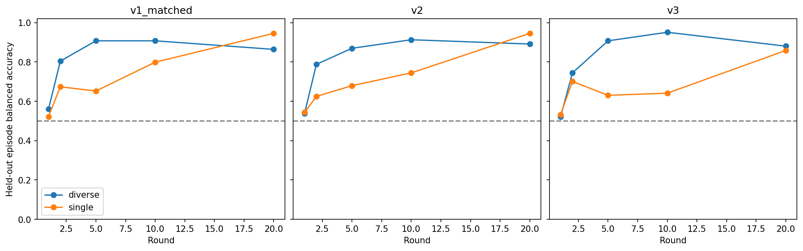

# Decision-time relative-speed decoding

Six RNN policies selected by final training return, with separate affine 128→2 probes at rounds 1, 2, 5, 10 and 20, plus a round-20 shuffled-label control. The target is red-faster (0) versus blue-faster (1). Features are original saved post-observation GRU states at t0 for v1_matched/v3 and t1 for v2, when the initial allocation is controllable. No trajectory averaging is used.

Every one of the 46 capability profiles contributes 16 fitting episodes and four held-out episodes: 736 fit and 184 test per policy. The shared split uses repetition indices from source order and numpy.default_rng(0). This measures held-out-episode decoding; it does not test transfer to unseen capability profiles.

Each independent class-balanced softmax probe uses full-batch Adam for 1000 steps, learning rate 0.01, no weight decay, seed 10000; the shuffled control permutes labels with seed 20000 and initializes its probe with seed 20000. Class weights use fitting labels only. The fitting helper is shared with the current relative-speed analysis. The historical producer was unavailable; methods were reconstructed from its saved arrays and the maintained fitting helper. Policies are not retrained.

| version | condition | seed | round | round_tick | kind | population | held_out_episodes | accuracy | balanced_accuracy | recall_0 | recall_1 | support_0 | support_1 |
| --- | --- | --- | --- | --- | --- | --- | --- | --- | --- | --- | --- | --- | --- |
| v1_matched | rnn_diverse_influence | 5 | 1 | 0 | primary | all | 184 | 0.5598 | 0.5598 | 0.5652 | 0.5543 | 92 | 92 |
| v1_matched | rnn_diverse_influence | 5 | 2 | 0 | primary | all | 184 | 0.8043 | 0.8043 | 0.8152 | 0.7935 | 92 | 92 |
| v1_matched | rnn_diverse_influence | 5 | 5 | 0 | primary | all | 184 | 0.9076 | 0.9076 | 0.9130 | 0.9022 | 92 | 92 |
| v1_matched | rnn_diverse_influence | 5 | 10 | 0 | primary | all | 184 | 0.9076 | 0.9076 | 0.9130 | 0.9022 | 92 | 92 |
| v1_matched | rnn_diverse_influence | 5 | 20 | 0 | primary | all | 184 | 0.8641 | 0.8641 | 0.8587 | 0.8696 | 92 | 92 |
| v1_matched | rnn_diverse_influence | 5 | 20 | 0 | shuffled_labels | all | 184 | 0.5163 | 0.5172 | 0.5294 | 0.5051 | 85 | 99 |
| v1_matched | rnn_single_influence | 5 | 1 | 0 | primary | all | 184 | 0.5217 | 0.5217 | 0.4674 | 0.5761 | 92 | 92 |
| v1_matched | rnn_single_influence | 5 | 2 | 0 | primary | all | 184 | 0.6739 | 0.6739 | 0.6957 | 0.6522 | 92 | 92 |
| v1_matched | rnn_single_influence | 5 | 5 | 0 | primary | all | 184 | 0.6522 | 0.6522 | 0.6957 | 0.6087 | 92 | 92 |
| v1_matched | rnn_single_influence | 5 | 10 | 0 | primary | all | 184 | 0.7989 | 0.7989 | 0.8370 | 0.7609 | 92 | 92 |
| v1_matched | rnn_single_influence | 5 | 20 | 0 | primary | all | 184 | 0.9457 | 0.9457 | 0.9565 | 0.9348 | 92 | 92 |
| v1_matched | rnn_single_influence | 5 | 20 | 0 | shuffled_labels | all | 184 | 0.5054 | 0.5005 | 0.4353 | 0.5657 | 85 | 99 |
| v2 | rnn_diverse_influence | 2 | 1 | 1 | primary | all | 184 | 0.5380 | 0.5380 | 0.5435 | 0.5326 | 92 | 92 |
| v2 | rnn_diverse_influence | 2 | 2 | 1 | primary | all | 184 | 0.7880 | 0.7880 | 0.7609 | 0.8152 | 92 | 92 |
| v2 | rnn_diverse_influence | 2 | 5 | 1 | primary | all | 184 | 0.8696 | 0.8696 | 0.8587 | 0.8804 | 92 | 92 |
| v2 | rnn_diverse_influence | 2 | 10 | 1 | primary | all | 184 | 0.9130 | 0.9130 | 0.8696 | 0.9565 | 92 | 92 |
| v2 | rnn_diverse_influence | 2 | 20 | 1 | primary | all | 184 | 0.8913 | 0.8913 | 0.9130 | 0.8696 | 92 | 92 |
| v2 | rnn_diverse_influence | 2 | 20 | 1 | shuffled_labels | all | 184 | 0.5163 | 0.5131 | 0.4706 | 0.5556 | 85 | 99 |
| v2 | rnn_single_influence | 4 | 1 | 1 | primary | all | 184 | 0.5435 | 0.5435 | 0.5326 | 0.5543 | 92 | 92 |
| v2 | rnn_single_influence | 4 | 2 | 1 | primary | all | 184 | 0.6250 | 0.6250 | 0.5870 | 0.6630 | 92 | 92 |
| v2 | rnn_single_influence | 4 | 5 | 1 | primary | all | 184 | 0.6793 | 0.6793 | 0.6739 | 0.6848 | 92 | 92 |
| v2 | rnn_single_influence | 4 | 10 | 1 | primary | all | 184 | 0.7446 | 0.7446 | 0.7500 | 0.7391 | 92 | 92 |
| v2 | rnn_single_influence | 4 | 20 | 1 | primary | all | 184 | 0.9457 | 0.9457 | 0.9457 | 0.9457 | 92 | 92 |
| v2 | rnn_single_influence | 4 | 20 | 1 | shuffled_labels | all | 184 | 0.5380 | 0.5358 | 0.5059 | 0.5657 | 85 | 99 |
| v3 | rnn_diverse_influence | 3 | 1 | 0 | primary | all | 184 | 0.5217 | 0.5217 | 0.4783 | 0.5652 | 92 | 92 |
| v3 | rnn_diverse_influence | 3 | 2 | 0 | primary | all | 184 | 0.7446 | 0.7446 | 0.7065 | 0.7826 | 92 | 92 |
| v3 | rnn_diverse_influence | 3 | 5 | 0 | primary | all | 184 | 0.9076 | 0.9076 | 0.9130 | 0.9022 | 92 | 92 |
| v3 | rnn_diverse_influence | 3 | 10 | 0 | primary | all | 184 | 0.9511 | 0.9511 | 0.9239 | 0.9783 | 92 | 92 |
| v3 | rnn_diverse_influence | 3 | 20 | 0 | primary | all | 184 | 0.8804 | 0.8804 | 0.9130 | 0.8478 | 92 | 92 |
| v3 | rnn_diverse_influence | 3 | 20 | 0 | shuffled_labels | all | 184 | 0.5380 | 0.5374 | 0.5294 | 0.5455 | 85 | 99 |
| v3 | rnn_single_influence | 5 | 1 | 0 | primary | all | 184 | 0.5326 | 0.5326 | 0.4674 | 0.5978 | 92 | 92 |
| v3 | rnn_single_influence | 5 | 2 | 0 | primary | all | 184 | 0.7011 | 0.7011 | 0.7174 | 0.6848 | 92 | 92 |
| v3 | rnn_single_influence | 5 | 5 | 0 | primary | all | 184 | 0.6304 | 0.6304 | 0.6196 | 0.6413 | 92 | 92 |
| v3 | rnn_single_influence | 5 | 10 | 0 | primary | all | 184 | 0.6413 | 0.6413 | 0.6630 | 0.6196 | 92 | 92 |
| v3 | rnn_single_influence | 5 | 20 | 0 | primary | all | 184 | 0.8587 | 0.8587 | 0.8804 | 0.8370 | 92 | 92 |
| v3 | rnn_single_influence | 5 | 20 | 0 | shuffled_labels | all | 184 | 0.4620 | 0.4601 | 0.4353 | 0.4848 | 85 | 99 |
