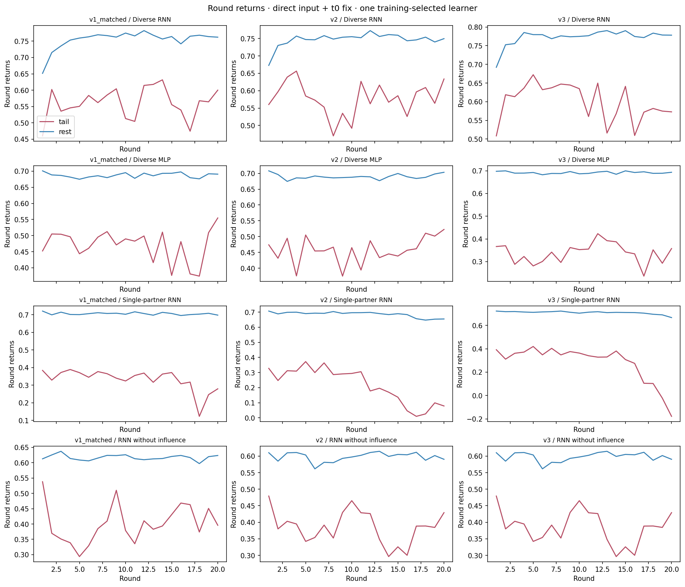
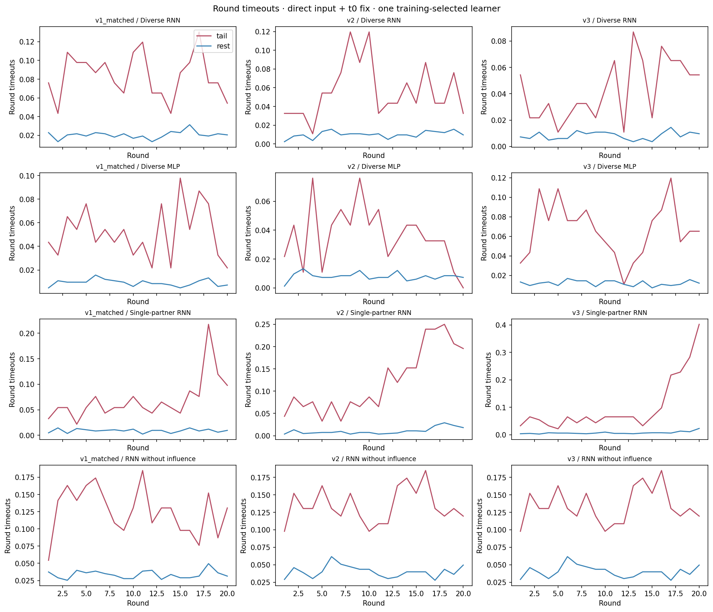
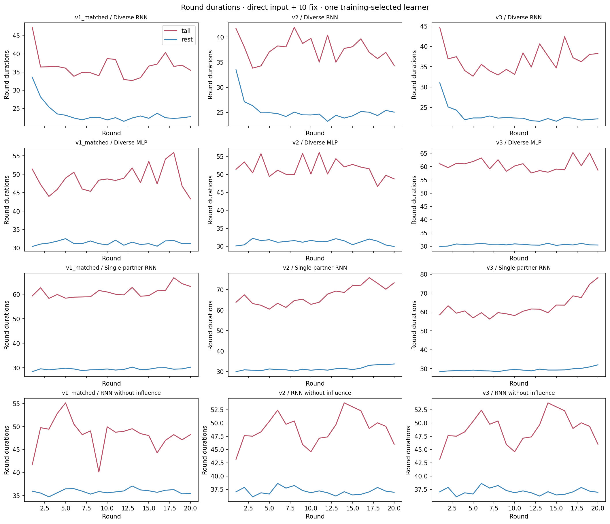
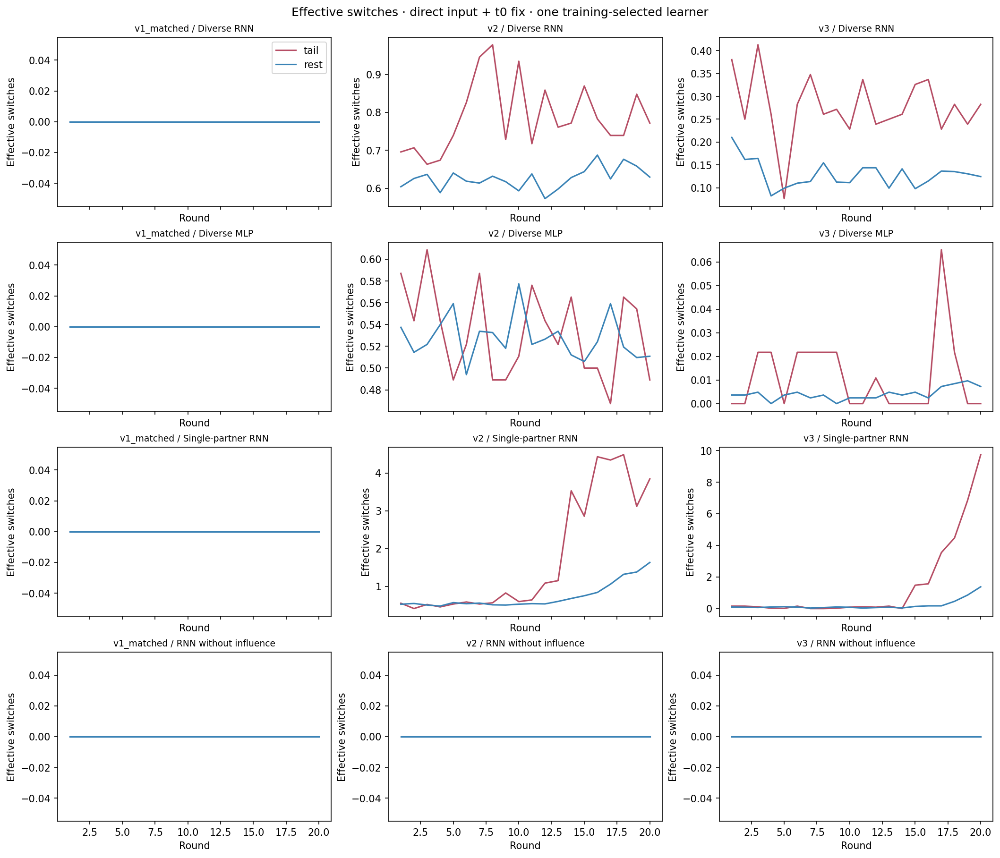
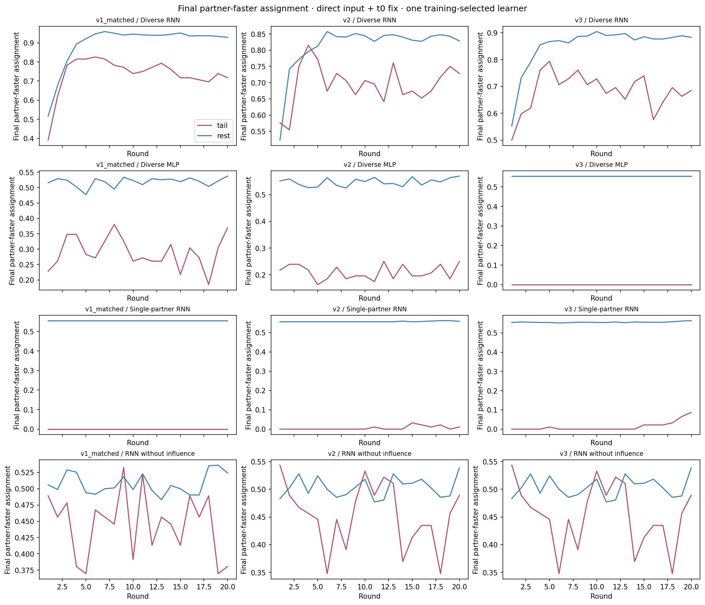
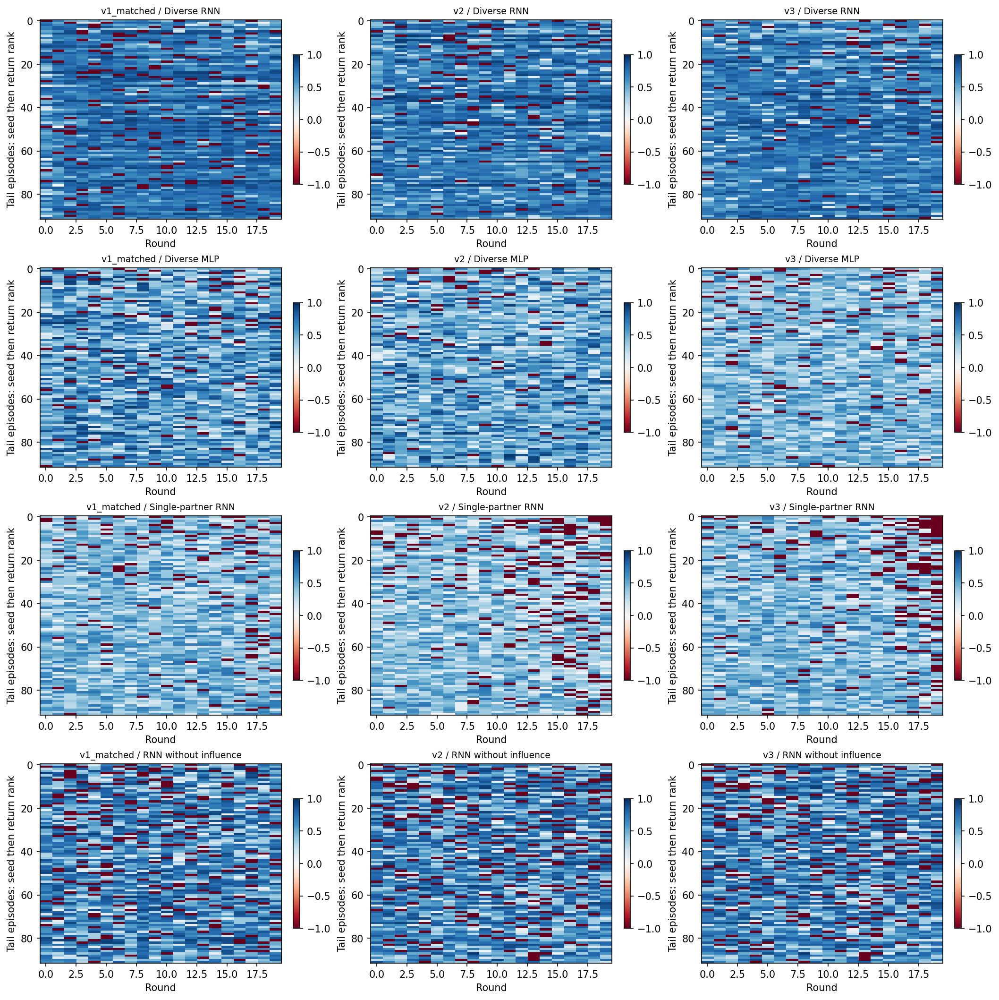

# Training-selected policies: lowest-return decile

Direct input + t0 fix · step penalty 0.01 · 12 policies · 11,040 episodes · 1,104 tail episodes · 22,080 tail rounds.

One seed per protocol/condition is selected by the largest unsmoothed final-update training return, with smaller seed winning a printed-score tie. Evaluation returns never select the learner.

Each policy contributes exactly its lowest 92 of 920 episodes, sorted by return, population and episode index. Boundary ties and tie-inclusive changes are recorded. Trend intervals use 4,000 paired whole-episode bootstrap draws within each policy and condition on tail selection; they do not include seed-selection uncertainty.

All measurements use the original saved 480 familiar and 440 novel episodes per policy. Terminal transitions are included and scan padding is excluded. The reward is R = 1.01 × successful rounds − 0.01 × total ticks; there is no explicit switching fine. An assignment labels the ego goal; the partner takes the other goal. Capability delay d allows a movement opportunity every d+1 ticks. Switch counts exclude initialization and round resets. Switching and returns are observational associations, not treatment effects. Positions and navigation actions were not recorded, so these records cannot distinguish wandering, collisions, and waiting at goals. A trend inside an outcome-selected tail is not evidence of learning or memory use. The single-partner RNN trained only on (1,4); the other 23 familiar-reference profiles are unseen for it.

Geometry-aware oracle comparisons use the matching 1,096-layout corpus and recorded initial assignment. They grant hidden capability information and informed navigation/switching; they are diagnostic ceilings, not an attainable policy baseline. Assignment opportunity gaps in no-influence controls are imposed by the environment, not ego decision errors.

## Current diagnoses

| version | condition | seed | training_return | tail_mean_return | rest_mean_return | late_minus_early | trend | tail_timeout_rounds | tail_switches_per_round | tail_final_partner_faster |
| --- | --- | --- | --- | --- | --- | --- | --- | --- | --- | --- |
| v1_matched | rnn_diverse_influence | 5 | 14.0140 | 11.2135 | 15.0884 | 0.0103 | approximately flat | 154 | 0.0000 | 0.7364 |
| v1_matched | mlp_diverse_influence | 1 | 13.4310 | 9.4153 | 13.7468 | -0.0203 | approximately flat | 95 | 0.0000 | 0.2897 |
| v1_matched | rnn_single_influence | 5 | 17.3330 | 6.6446 | 14.1280 | -0.1143 | decreasing | 127 | 0.0000 | 0.0000 |
| v1_matched | rnn_diverse_noinfluence | 3 | 11.6270 | 8.0095 | 12.3417 | 0.0522 | no clear trend | 231 | 0.0000 | 0.4451 |
| v2 | rnn_diverse_influence | 2 | 14.2380 | 11.5477 | 14.9413 | -0.0217 | approximately flat | 104 | 0.7875 | 0.6951 |
| v2 | mlp_diverse_influence | 4 | 13.2870 | 9.1499 | 13.7955 | 0.0344 | approximately flat | 67 | 0.5326 | 0.2092 |
| v2 | rnn_single_influence | 4 | 17.3140 | 4.3511 | 13.7139 | -0.2615 | decreasing | 222 | 1.7549 | 0.0054 |
| v2 | rnn_diverse_noinfluence | 5 | 11.7740 | 7.7091 | 11.9624 | -0.0217 | approximately flat | 247 | 0.0000 | 0.4533 |
| v3 | rnn_diverse_influence | 3 | 14.8110 | 11.9923 | 15.4506 | -0.0477 | approximately flat | 79 | 0.2777 | 0.6821 |
| v3 | mlp_diverse_influence | 4 | 13.5160 | 6.7589 | 13.8357 | -0.0111 | approximately flat | 122 | 0.0114 | 0.0000 |
| v3 | rnn_single_influence | 5 | 17.4360 | 5.6642 | 14.1752 | -0.3143 | decreasing | 185 | 1.4348 | 0.0130 |
| v3 | rnn_diverse_noinfluence | 5 | 11.7740 | 7.7091 | 11.9624 | -0.0217 | approximately flat | 247 | 0.0000 | 0.4533 |

[Actor, critic and observation-channel audit](math_audit/report.md)

[48-page selected-policy casebook](cases/selected_representative_cases.pdf)

## Profile composition and switching checks

The profile-standardized reference reweights all episodes to the tail’s capability mixture, including the tail itself. It is descriptive, not an independent control. Lost success credit plus extra tick cost exactly decomposes the rest-minus-tail return gap. High-switch versus zero-switch comparisons match profile, round and initial assignment, but still leave layout and time-at-risk confounding.

