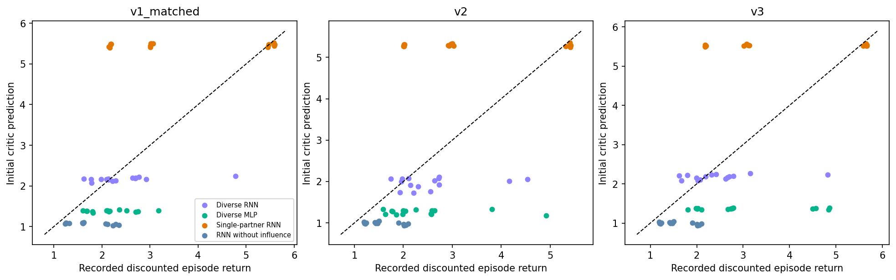

# Actor, critic and observation-channel audit

Direct input + t0 fix; actual step penalty 0.01.

All measurements use the original saved 480 familiar and 440 novel episodes per policy. Terminal transitions are included and scan padding is excluded. The reward is R = 1.01 × successful rounds − 0.01 × total ticks; there is no explicit switching fine. An assignment labels the ego goal; the partner takes the other goal. Capability delay d allows a movement opportunity every d+1 ticks. Switch counts exclude initialization and round resets. Switching and returns are observational associations, not treatment effects. Positions and navigation actions were not recorded, so these records cannot distinguish wandering, collisions, and waiting at goals. A trend inside an outcome-selected tail is not evidence of learning or memory use. The single-partner RNN trained only on (1,4); the other 23 familiar-reference profiles are unseen for it.

Actor probabilities and critic values are computed from frozen checkpoint heads applied to original saved post-observation GRU states. The full discounted critic target includes the recorded terminal reward and has zero terminal bootstrap. Policies are not fitted and no new environment rollouts are performed. Separate diagnostic capability decoders are fitted in the selected-policy audit.

MLPs have no saved meaningful hidden state. Their exact round-start and next stationary observations are reconstructed from the recorded layout, own allocation and phase bit. Full-trajectory MLP critic values are not invented. The phase comparison records the current values at t0 and t1; the phase-bit-only counterfactual is saved separately in the start table.

Zero-history probes reset the pre-observation GRU state while preserving the current observation. Allocation-channel probes vary the ego’s own previous request, not a message revealing partner capability. The factual legal mask is held fixed; initial forced-mask changes are marked explicitly. These probes do not establish causal episode-level performance effects.

## Equal-learner RNN summary

| version | condition | decision_p_partner_faster | decision_p_red | mean_p_switch | mean_subsequent_p_switch | mean_entropy | initial_value_bias | critic_rmse | terminal_td |
| --- | --- | --- | --- | --- | --- | --- | --- | --- | --- |
| v1_matched | rnn_diverse_influence | 0.5761 | 0.7054 | 0.0000 | 0.0000 | 0.8624 | -0.0104 | 0.7121 | 0.0916 |
| v1_matched | rnn_diverse_noinfluence | 0.5015 | 0.3994 | 0.0000 | 0.0000 | 0.7078 | -0.1280 | 0.6576 | 0.1352 |
| v1_matched | rnn_single_influence | 0.5000 | 0.0000 | 0.0000 | 0.0000 | 0.5158 | 1.5188 | 1.9260 | 0.1008 |
| v2 | rnn_diverse_influence | 0.6377 | 0.4820 | 0.0285 | 0.0199 | 0.7704 | -0.1095 | 0.8153 | 0.1289 |
| v2 | rnn_diverse_noinfluence | 0.4982 | 0.5769 | 0.0000 | 0.0000 | 0.9835 | -0.1172 | 0.6495 | 0.1483 |
| v2 | rnn_single_influence | 0.5023 | 0.0039 | 0.0328 | 0.0115 | 0.5146 | 1.4611 | 1.8756 | 0.1052 |
| v3 | rnn_diverse_influence | 0.5919 | 0.6919 | 0.0045 | 0.0047 | 0.8628 | -0.0139 | 0.6969 | 0.1036 |
| v3 | rnn_diverse_noinfluence | 0.4991 | 0.4997 | 0.0000 | 0.0000 | 0.9835 | -0.1172 | 0.6495 | 0.1483 |
| v3 | rnn_single_influence | 0.5031 | 0.0045 | 0.0067 | 0.0068 | 0.4610 | 1.6846 | 2.0613 | 0.0689 |

## Reconstruction coverage

| version | condition | seed | saved_hidden_states_analyzed | maximum_start_hidden_reconstruction_error | observation_probes | mlp_start_observations | GAMMA | GAE_LAMBDA | CLIP_EPS | ENT_COEF | VF_COEF | MAX_GRAD_NORM | LR | full_training_trace | step_penalty |
| --- | --- | --- | --- | --- | --- | --- | --- | --- | --- | --- | --- | --- | --- | --- | --- |
| v1_matched | rnn_diverse_influence | 1 | 611076 | 0.0009 | 36800 | 0 | 0.9900 | 0.9500 | 0.2000 | 0.0100 | 1.0000 | 0.2500 | 0.0005 | False | 0.0100 |
| v1_matched | rnn_diverse_influence | 2 | 612489 | 0.0010 | 36800 | 0 | 0.9900 | 0.9500 | 0.2000 | 0.0100 | 1.0000 | 0.2500 | 0.0005 | False | 0.0100 |
| v1_matched | rnn_diverse_influence | 3 | 610061 | 0.0009 | 36800 | 0 | 0.9900 | 0.9500 | 0.2000 | 0.0100 | 1.0000 | 0.2500 | 0.0005 | False | 0.0100 |
| v1_matched | rnn_diverse_influence | 4 | 612565 | 0.0008 | 36800 | 0 | 0.9900 | 0.9500 | 0.2000 | 0.0100 | 1.0000 | 0.2500 | 0.0005 | False | 0.0100 |
| v1_matched | rnn_diverse_influence | 5 | 456019 | 0.0010 | 36800 | 0 | 0.9900 | 0.9500 | 0.2000 | 0.0100 | 1.0000 | 0.2500 | 0.0005 | False | 0.0100 |
| v1_matched | mlp_diverse_influence | 1 | 0 | 0.0000 | 0 | 36800 | 0.9900 | 0.9500 | 0.2000 | 0.0100 | 1.0000 | 0.2500 | 0.0005 | False | 0.0100 |
| v1_matched | mlp_diverse_influence | 2 | 0 | 0.0000 | 0 | 36800 | 0.9900 | 0.9500 | 0.2000 | 0.0100 | 1.0000 | 0.2500 | 0.0005 | False | 0.0100 |
| v1_matched | mlp_diverse_influence | 3 | 0 | 0.0000 | 0 | 36800 | 0.9900 | 0.9500 | 0.2000 | 0.0100 | 1.0000 | 0.2500 | 0.0005 | False | 0.0100 |
| v1_matched | mlp_diverse_influence | 4 | 0 | 0.0000 | 0 | 36800 | 0.9900 | 0.9500 | 0.2000 | 0.0100 | 1.0000 | 0.2500 | 0.0005 | False | 0.0100 |
| v1_matched | mlp_diverse_influence | 5 | 0 | 0.0000 | 0 | 36800 | 0.9900 | 0.9500 | 0.2000 | 0.0100 | 1.0000 | 0.2500 | 0.0005 | False | 0.0100 |
| v1_matched | rnn_single_influence | 1 | 601523 | 0.0010 | 36800 | 0 | 0.9900 | 0.9500 | 0.2000 | 0.0100 | 1.0000 | 0.2500 | 0.0005 | False | 0.0100 |
| v1_matched | rnn_single_influence | 2 | 598161 | 0.0011 | 36800 | 0 | 0.9900 | 0.9500 | 0.2000 | 0.0100 | 1.0000 | 0.2500 | 0.0005 | False | 0.0100 |
| v1_matched | rnn_single_influence | 3 | 596657 | 0.0010 | 36800 | 0 | 0.9900 | 0.9500 | 0.2000 | 0.0100 | 1.0000 | 0.2500 | 0.0005 | False | 0.0100 |
| v1_matched | rnn_single_influence | 4 | 595500 | 0.0013 | 36800 | 0 | 0.9900 | 0.9500 | 0.2000 | 0.0100 | 1.0000 | 0.2500 | 0.0005 | False | 0.0100 |
| v1_matched | rnn_single_influence | 5 | 599492 | 0.0011 | 36800 | 0 | 0.9900 | 0.9500 | 0.2000 | 0.0100 | 1.0000 | 0.2500 | 0.0005 | False | 0.0100 |
| v1_matched | rnn_diverse_noinfluence | 1 | 683255 | 0.0014 | 36800 | 0 | 0.9900 | 0.9500 | 0.2000 | 0.0100 | 1.0000 | 0.2500 | 0.0005 | False | 0.0100 |
| v1_matched | rnn_diverse_noinfluence | 2 | 681893 | 0.0010 | 36800 | 0 | 0.9900 | 0.9500 | 0.2000 | 0.0100 | 1.0000 | 0.2500 | 0.0005 | False | 0.0100 |
| v1_matched | rnn_diverse_noinfluence | 3 | 683033 | 0.0010 | 36800 | 0 | 0.9900 | 0.9500 | 0.2000 | 0.0100 | 1.0000 | 0.2500 | 0.0005 | False | 0.0100 |
| v1_matched | rnn_diverse_noinfluence | 4 | 684609 | 0.0011 | 36800 | 0 | 0.9900 | 0.9500 | 0.2000 | 0.0100 | 1.0000 | 0.2500 | 0.0005 | False | 0.0100 |
| v1_matched | rnn_diverse_noinfluence | 5 | 688403 | 0.0010 | 36800 | 0 | 0.9900 | 0.9500 | 0.2000 | 0.0100 | 1.0000 | 0.2500 | 0.0005 | False | 0.0100 |
| v2 | rnn_diverse_influence | 1 | 549395 | 0.0012 | 36800 | 0 | 0.9900 | 0.9500 | 0.2000 | 0.0100 | 1.0000 | 0.2500 | 0.0005 | False | 0.0100 |
| v2 | rnn_diverse_influence | 2 | 487653 | 0.0013 | 36800 | 0 | 0.9900 | 0.9500 | 0.2000 | 0.0100 | 1.0000 | 0.2500 | 0.0005 | False | 0.0100 |
| v2 | rnn_diverse_influence | 3 | 515310 | 0.0010 | 36800 | 0 | 0.9900 | 0.9500 | 0.2000 | 0.0100 | 1.0000 | 0.2500 | 0.0005 | False | 0.0100 |
| v2 | rnn_diverse_influence | 4 | 565008 | 0.0012 | 36800 | 0 | 0.9900 | 0.9500 | 0.2000 | 0.0100 | 1.0000 | 0.2500 | 0.0005 | False | 0.0100 |
| v2 | rnn_diverse_influence | 5 | 563286 | 0.0011 | 36800 | 0 | 0.9900 | 0.9500 | 0.2000 | 0.0100 | 1.0000 | 0.2500 | 0.0005 | False | 0.0100 |
| v2 | mlp_diverse_influence | 1 | 0 | 0.0000 | 0 | 36800 | 0.9900 | 0.9500 | 0.2000 | 0.0100 | 1.0000 | 0.2500 | 0.0005 | False | 0.0100 |
| v2 | mlp_diverse_influence | 2 | 0 | 0.0000 | 0 | 36800 | 0.9900 | 0.9500 | 0.2000 | 0.0100 | 1.0000 | 0.2500 | 0.0005 | False | 0.0100 |
| v2 | mlp_diverse_influence | 3 | 0 | 0.0000 | 0 | 36800 | 0.9900 | 0.9500 | 0.2000 | 0.0100 | 1.0000 | 0.2500 | 0.0005 | False | 0.0100 |
| v2 | mlp_diverse_influence | 4 | 0 | 0.0000 | 0 | 36800 | 0.9900 | 0.9500 | 0.2000 | 0.0100 | 1.0000 | 0.2500 | 0.0005 | False | 0.0100 |
| v2 | mlp_diverse_influence | 5 | 0 | 0.0000 | 0 | 36800 | 0.9900 | 0.9500 | 0.2000 | 0.0100 | 1.0000 | 0.2500 | 0.0005 | False | 0.0100 |
| v2 | rnn_single_influence | 1 | 668769 | 0.0009 | 36800 | 0 | 0.9900 | 0.9500 | 0.2000 | 0.0100 | 1.0000 | 0.2500 | 0.0005 | False | 0.0100 |
| v2 | rnn_single_influence | 2 | 672750 | 0.0013 | 36800 | 0 | 0.9900 | 0.9500 | 0.2000 | 0.0100 | 1.0000 | 0.2500 | 0.0005 | False | 0.0100 |
| v2 | rnn_single_influence | 3 | 648475 | 0.0013 | 36800 | 0 | 0.9900 | 0.9500 | 0.2000 | 0.0100 | 1.0000 | 0.2500 | 0.0005 | False | 0.0100 |
| v2 | rnn_single_influence | 4 | 642964 | 0.0012 | 36800 | 0 | 0.9900 | 0.9500 | 0.2000 | 0.0100 | 1.0000 | 0.2500 | 0.0005 | False | 0.0100 |
| v2 | rnn_single_influence | 5 | 651554 | 0.0011 | 36800 | 0 | 0.9900 | 0.9500 | 0.2000 | 0.0100 | 1.0000 | 0.2500 | 0.0005 | False | 0.0100 |
| v2 | rnn_diverse_noinfluence | 1 | 705978 | 0.0011 | 36800 | 0 | 0.9900 | 0.9500 | 0.2000 | 0.0100 | 1.0000 | 0.2500 | 0.0005 | False | 0.0100 |
| v2 | rnn_diverse_noinfluence | 2 | 700739 | 0.0010 | 36800 | 0 | 0.9900 | 0.9500 | 0.2000 | 0.0100 | 1.0000 | 0.2500 | 0.0005 | False | 0.0100 |
| v2 | rnn_diverse_noinfluence | 3 | 703949 | 0.0010 | 36800 | 0 | 0.9900 | 0.9500 | 0.2000 | 0.0100 | 1.0000 | 0.2500 | 0.0005 | False | 0.0100 |
| v2 | rnn_diverse_noinfluence | 4 | 712493 | 0.0009 | 36800 | 0 | 0.9900 | 0.9500 | 0.2000 | 0.0100 | 1.0000 | 0.2500 | 0.0005 | False | 0.0100 |
| v2 | rnn_diverse_noinfluence | 5 | 704774 | 0.0011 | 36800 | 0 | 0.9900 | 0.9500 | 0.2000 | 0.0100 | 1.0000 | 0.2500 | 0.0005 | False | 0.0100 |
| v3 | rnn_diverse_influence | 1 | 609481 | 0.0010 | 36800 | 0 | 0.9900 | 0.9500 | 0.2000 | 0.0100 | 1.0000 | 0.2500 | 0.0005 | False | 0.0100 |
| v3 | rnn_diverse_influence | 2 | 557836 | 0.0012 | 36800 | 0 | 0.9900 | 0.9500 | 0.2000 | 0.0100 | 1.0000 | 0.2500 | 0.0005 | False | 0.0100 |
| v3 | rnn_diverse_influence | 3 | 446946 | 0.0010 | 36800 | 0 | 0.9900 | 0.9500 | 0.2000 | 0.0100 | 1.0000 | 0.2500 | 0.0005 | False | 0.0100 |
| v3 | rnn_diverse_influence | 4 | 606411 | 0.0011 | 36800 | 0 | 0.9900 | 0.9500 | 0.2000 | 0.0100 | 1.0000 | 0.2500 | 0.0005 | False | 0.0100 |
| v3 | rnn_diverse_influence | 5 | 604625 | 0.0011 | 36800 | 0 | 0.9900 | 0.9500 | 0.2000 | 0.0100 | 1.0000 | 0.2500 | 0.0005 | False | 0.0100 |
| v3 | mlp_diverse_influence | 1 | 0 | 0.0000 | 0 | 36800 | 0.9900 | 0.9500 | 0.2000 | 0.0100 | 1.0000 | 0.2500 | 0.0005 | False | 0.0100 |
| v3 | mlp_diverse_influence | 2 | 0 | 0.0000 | 0 | 36800 | 0.9900 | 0.9500 | 0.2000 | 0.0100 | 1.0000 | 0.2500 | 0.0005 | False | 0.0100 |
| v3 | mlp_diverse_influence | 3 | 0 | 0.0000 | 0 | 36800 | 0.9900 | 0.9500 | 0.2000 | 0.0100 | 1.0000 | 0.2500 | 0.0005 | False | 0.0100 |
| v3 | mlp_diverse_influence | 4 | 0 | 0.0000 | 0 | 36800 | 0.9900 | 0.9500 | 0.2000 | 0.0100 | 1.0000 | 0.2500 | 0.0005 | False | 0.0100 |
| v3 | mlp_diverse_influence | 5 | 0 | 0.0000 | 0 | 36800 | 0.9900 | 0.9500 | 0.2000 | 0.0100 | 1.0000 | 0.2500 | 0.0005 | False | 0.0100 |
| v3 | rnn_single_influence | 1 | 614697 | 0.0011 | 36800 | 0 | 0.9900 | 0.9500 | 0.2000 | 0.0100 | 1.0000 | 0.2500 | 0.0005 | False | 0.0100 |
| v3 | rnn_single_influence | 2 | 599185 | 0.0013 | 36800 | 0 | 0.9900 | 0.9500 | 0.2000 | 0.0100 | 1.0000 | 0.2500 | 0.0005 | False | 0.0100 |
| v3 | rnn_single_influence | 3 | 621018 | 0.0011 | 36800 | 0 | 0.9900 | 0.9500 | 0.2000 | 0.0100 | 1.0000 | 0.2500 | 0.0005 | False | 0.0100 |
| v3 | rnn_single_influence | 4 | 615222 | 0.0013 | 36800 | 0 | 0.9900 | 0.9500 | 0.2000 | 0.0100 | 1.0000 | 0.2500 | 0.0005 | False | 0.0100 |
| v3 | rnn_single_influence | 5 | 602082 | 0.0013 | 36800 | 0 | 0.9900 | 0.9500 | 0.2000 | 0.0100 | 1.0000 | 0.2500 | 0.0005 | False | 0.0100 |
| v3 | rnn_diverse_noinfluence | 1 | 705978 | 0.0011 | 36800 | 0 | 0.9900 | 0.9500 | 0.2000 | 0.0100 | 1.0000 | 0.2500 | 0.0005 | False | 0.0100 |
| v3 | rnn_diverse_noinfluence | 2 | 700739 | 0.0010 | 36800 | 0 | 0.9900 | 0.9500 | 0.2000 | 0.0100 | 1.0000 | 0.2500 | 0.0005 | False | 0.0100 |
| v3 | rnn_diverse_noinfluence | 3 | 703949 | 0.0010 | 36800 | 0 | 0.9900 | 0.9500 | 0.2000 | 0.0100 | 1.0000 | 0.2500 | 0.0005 | False | 0.0100 |
| v3 | rnn_diverse_noinfluence | 4 | 712493 | 0.0009 | 36800 | 0 | 0.9900 | 0.9500 | 0.2000 | 0.0100 | 1.0000 | 0.2500 | 0.0005 | False | 0.0100 |
| v3 | rnn_diverse_noinfluence | 5 | 704774 | 0.0011 | 36800 | 0 | 0.9900 | 0.9500 | 0.2000 | 0.0100 | 1.0000 | 0.2500 | 0.0005 | False | 0.0100 |

