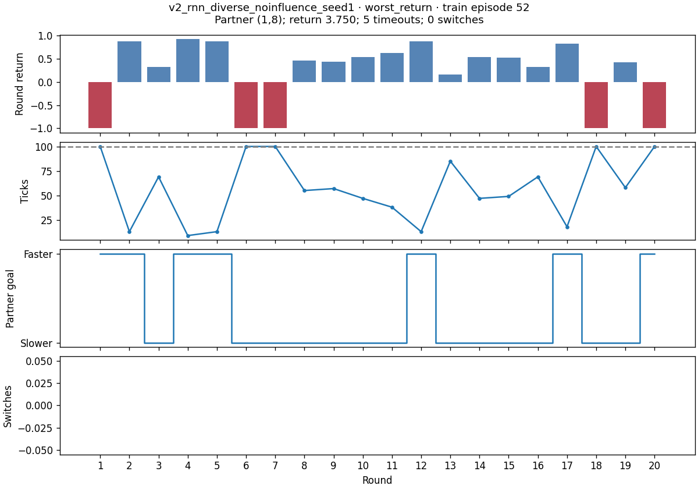
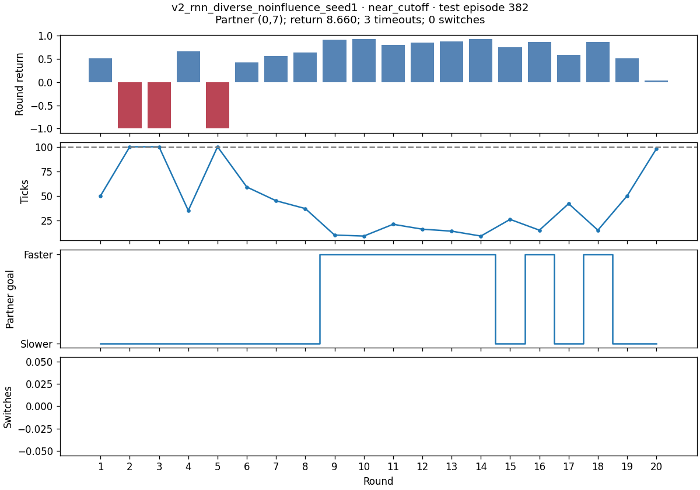
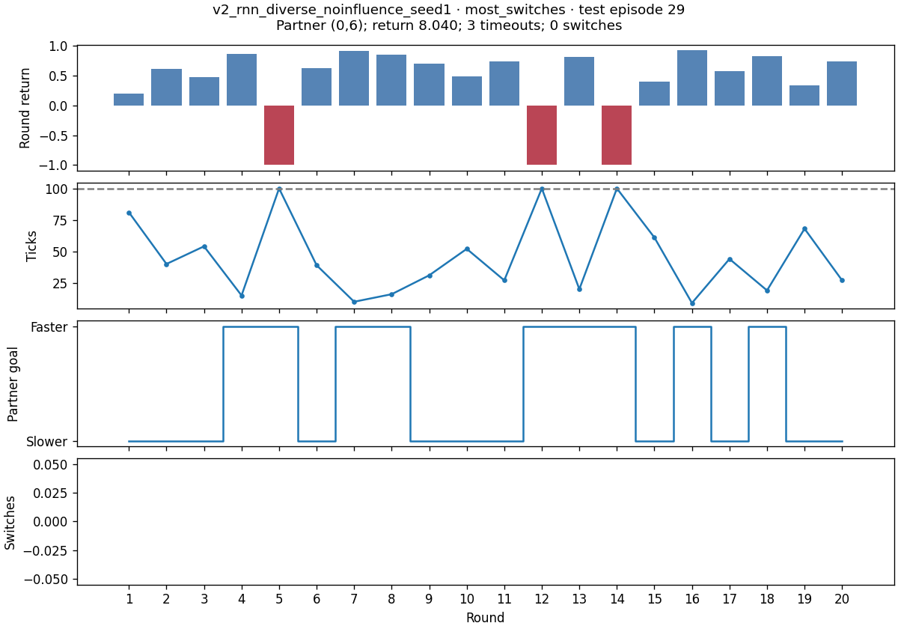
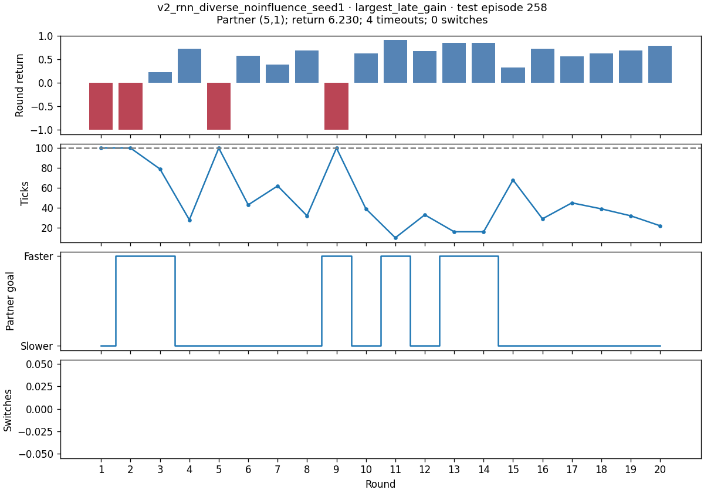

# v2_rnn_diverse_noinfluence_seed1

Direct input + t0 fix; step penalty 0.01. Final-update training return 10.860.

[Checkpoint](/juice6/u/jshe/emergent_partner_grid/train/train_logs/v2_t0fix_direct_input/v1_matched_v2_v3_20261022_080155_t0fix_direct_input/rnn_diverse_noinfluence_seed1_t0fix_direct_input.safetensors) · [Saved config](/juice6/u/jshe/emergent_partner_grid/train/train_logs/v2_t0fix_direct_input/v1_matched_v2_v3_20261022_080155_t0fix_direct_input/rnn_diverse_noinfluence_seed1_t0fix_direct_input_config.json) · [Matching source](/juice6/u/jshe/emergent_partner_grid/train/run_snapshots/v1_matched_v2_v3_20261022_080155_t0fix_direct_input/v2_t0fix_direct_input/source)

| seed | tail_mean_return | rest_mean_return | late_minus_early | delta_ci_low | delta_ci_high | trend | tail_timeout_rounds | tail_switches_per_round |
| --- | --- | --- | --- | --- | --- | --- | --- | --- |
| 1 | 7.3473 | 11.9527 | 0.0298 | -0.0594 | 0.1163 | approximately flat | 277 | 0.0000 |

All measurements use the original saved 480 familiar and 440 novel episodes per policy. Terminal transitions are included and scan padding is excluded. The reward is R = 1.01 × successful rounds − 0.01 × total ticks; there is no explicit switching fine. An assignment labels the ego goal; the partner takes the other goal. Capability delay d allows a movement opportunity every d+1 ticks. Switch counts exclude initialization and round resets. Switching and returns are observational associations, not treatment effects. Positions and navigation actions were not recorded, so these records cannot distinguish wandering, collisions, and waiting at goals. A trend inside an outcome-selected tail is not evidence of learning or memory use. The single-partner RNN trained only on (1,4); the other 23 familiar-reference profiles are unseen for it.

## Four distinct recorded tail cases

### worst_return

Layouts: train_0147;train_1218;train_1692;train_1522;train_0041;train_1622;train_1464;train_1465;train_0047;train_0487;train_0714;train_0610;train_1387;train_1772;train_0045;train_1030;train_1228;train_1637;train_0964;train_1252

### near_cutoff

Layouts: train_1983;train_0365;train_1700;train_0479;train_1383;train_0947;train_0115;train_1532;train_0047;train_0761;train_1202;train_1249;train_0782;train_1307;train_1130;train_0246;train_1224;train_0572;train_0001;train_1074

### most_switches

Layouts: train_1571;train_0688;train_1478;train_1789;train_0227;train_1216;train_0362;train_0987;train_0599;train_0062;train_0116;train_1327;train_0778;train_1295;train_0469;train_1601;train_1673;train_0532;train_1052;train_1917

### largest_late_gain

Layouts: train_0695;train_1263;train_1302;train_0612;train_1624;train_1939;train_1859;train_0299;train_1737;train_1120;train_0383;train_0645;train_1010;train_0358;train_1009;train_0603;train_0381;train_0130;train_1237;train_1794

