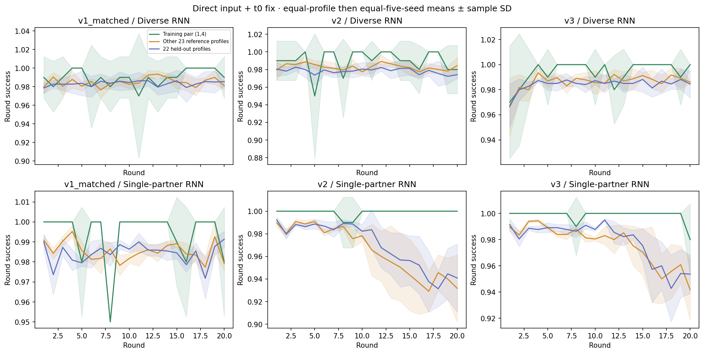
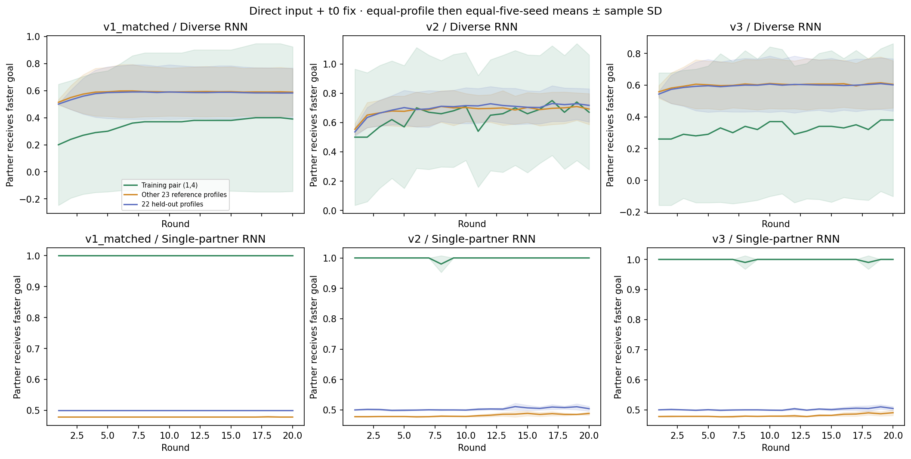
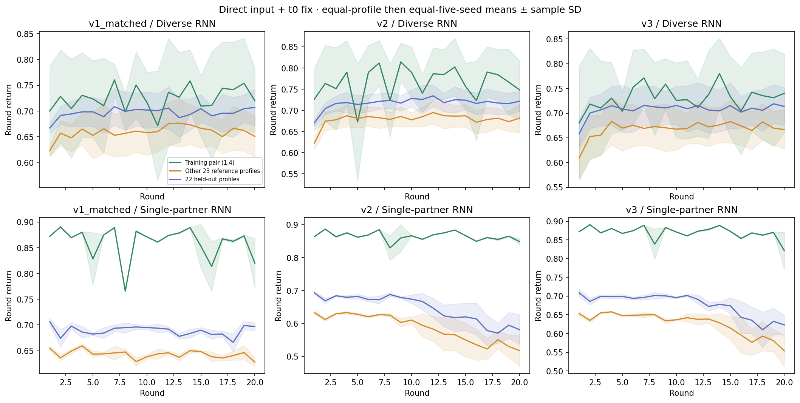
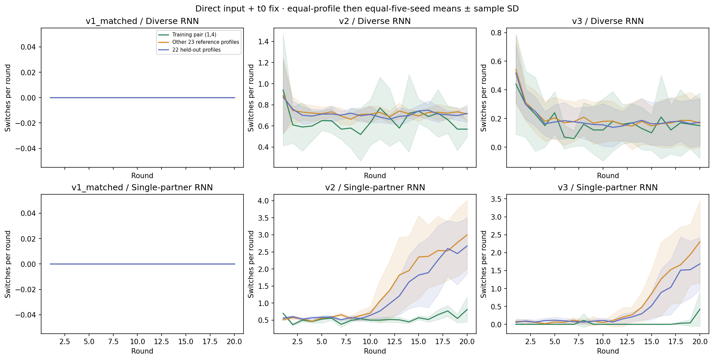
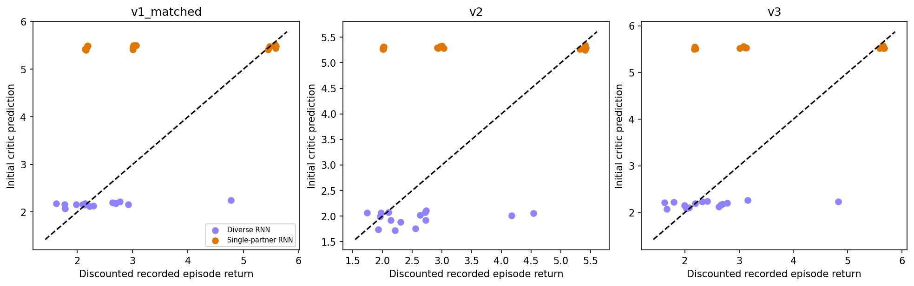

# Single-partner generalization

Current direct-input/t0-fixed policies; step penalty 0.01. Compare all five single-partner RNN learners with all five diverse-partner RNN learners in each protocol: 30 policies.

The groups are the actual single training partner (1,4), the other 23 reference profiles, and 22 held-out profiles. Only the first group was familiar during single-partner training; all 24 reference profiles were familiar to diverse-partner learners. Average repetitions within profile, then profiles within group, then the five learner seeds. Bands are sample SD across learners, not episode-level uncertainty.

All measurements use the original saved 480 familiar and 440 novel episodes per policy. Terminal transitions are included and scan padding is excluded. The reward is R = 1.01 × successful rounds − 0.01 × total ticks; there is no explicit switching fine. An assignment labels the ego goal; the partner takes the other goal. Capability delay d allows a movement opportunity every d+1 ticks. Switch counts exclude initialization and round resets. Switching and returns are observational associations, not treatment effects. Positions and navigation actions were not recorded, so these records cannot distinguish wandering, collisions, and waiting at goals. A trend inside an outcome-selected tail is not evidence of learning or memory use. The single-partner RNN trained only on (1,4); the other 23 familiar-reference profiles are unseen for it.

## Episode and critic summaries

| version | condition | group | episode_return | initial_value | discounted_return | value_bias |
| --- | --- | --- | --- | --- | --- | --- |
| v1_matched | rnn_diverse_influence | held_out | 13.9387 | 2.1908 | 2.7435 | -0.5527 |
| v1_matched | rnn_diverse_influence | other_reference | 13.1868 | 2.1551 | 2.1285 | 0.0266 |
| v1_matched | rnn_diverse_influence | training_partner | 14.4985 | 2.1550 | 2.4358 | -0.2808 |
| v1_matched | rnn_single_influence | held_out | 13.7760 | 5.4753 | 3.0247 | 2.4506 |
| v1_matched | rnn_single_influence | other_reference | 12.8629 | 5.4570 | 2.1705 | 3.2865 |
| v1_matched | rnn_single_influence | training_partner | 17.2188 | 5.4683 | 5.5341 | -0.0658 |
| v2 | rnn_diverse_influence | held_out | 14.3499 | 1.9762 | 2.6749 | -0.6987 |
| v2 | rnn_diverse_influence | other_reference | 13.5790 | 1.9575 | 2.0227 | -0.0652 |
| v2 | rnn_diverse_influence | training_partner | 15.3150 | 1.9476 | 2.9925 | -1.0449 |
| v2 | rnn_single_influence | held_out | 12.9060 | 5.3013 | 2.9700 | 2.3313 |
| v2 | rnn_single_influence | other_reference | 11.7385 | 5.2879 | 2.0142 | 3.2737 |
| v2 | rnn_single_influence | training_partner | 17.2890 | 5.2846 | 5.3921 | -0.1076 |
| v3 | rnn_diverse_influence | held_out | 14.1472 | 2.1871 | 2.7848 | -0.5977 |
| v3 | rnn_diverse_influence | other_reference | 13.3655 | 2.1560 | 2.1420 | 0.0140 |
| v3 | rnn_diverse_influence | training_partner | 14.6216 | 2.1962 | 2.4471 | -0.2509 |
| v3 | rnn_single_influence | held_out | 13.5407 | 5.5340 | 3.0891 | 2.4449 |
| v3 | rnn_single_influence | other_reference | 12.5298 | 5.5198 | 2.1872 | 3.3326 |
| v3 | rnn_single_influence | training_partner | 17.3869 | 5.5349 | 5.6462 | -0.1113 |
